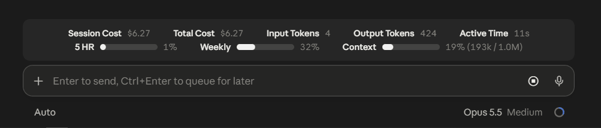
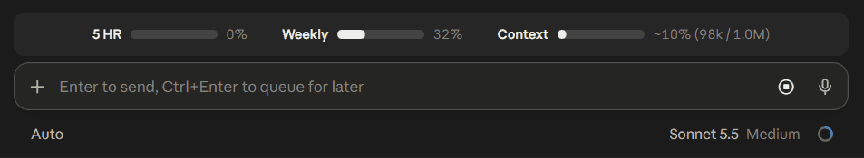

# claudeMods

A repository of small, and potentially useful, add-ons for the Claude Desktop app.

> [!WARNING]
> The terminal iteration of Claude Code, VS Code, and mobile platforms **ARE NOT**, and **WILL NOT** be supported.

## usageBands

Adds a band above the prompt box with two rows of monitors.

### Cost Row

The top row holds five monitors:

- **Session Cost**
- **Total Cost**: API cost of every session since the mod was installed.
- **Input Tokens**
- **Output Tokens**
- **Active Time**: time spent on turns this session, excluding idle time.



In a narrow window `Active Time` hides first, then `Input Tokens`, instead of wrapping onto a second line. Hidden monitors are always still tracked.
The cost monitors update with each reply and tool call, and the token and time monitors when a turn ends, so an idle chat keeps its last readings.

> [!WARNING]
> Every monitor except `Session Cost` is stored in `%USERPROFILE%\claudeMods\data\apiUsageLedger.json`. Deleting or moving the file **WILL** reset them.

### Limits Row

The bottom row holds three "progress" monitors:

- **5 HR**
- **Weekly**
- **Context**



Each monitor turns yellow at 60% and red at 80% by default.
In a narrow window the bars get shorter instead of wrapping onto a second line. Once they reach their minimum length, `Context` hides.
The monitors update with each reply and tool call, and not on a timer -- so an idle chat will keep its last known and active readings.

### Settings

Settings are stored in `%USERPROFILE%\claudeMods\userConfig\usageBandsSettings.json`.
The mod writes the file with every default the first time it runs.

| Setting      | Default | What It Does                                               |
| ------------ | ------- | ---------------------------------------------------------- |
| `showCost`   | `true`  | Shows the cost row.                                        |
| `showLimits` | `true`  | Shows the limits row.                                      |
| `hide`       | `[]`    | Monitor names never shown, for example `["Input Tokens"]`. |
| `yellowAt`   | `60`    | Percent at which a limits bar turns yellow.                |
| `redAt`      | `80`    | Percent at which a limits bar turns red.                   |

A change applies at the next prompt, reply or tool call, with no restart.
A setting that is missing or has the wrong type uses its default, and a file that is not valid JSON uses every default.

---

## Install Instructions

1. Clone this repository to `%USERPROFILE%\claudeMods` (recommended location).

   ```powershell
   git clone https://git.jorb.gay/jorban/claudeMods.git "$env:USERPROFILE\claudeMods"
   ```

2. Set a user environment variable named `CLAUDE_CODE_PLUGIN_DIRS` to the mod's folder, `%USERPROFILE%\claudeMods\usageBands`.

   ```powershell
   [Environment]::SetEnvironmentVariable('CLAUDE_CODE_PLUGIN_DIRS', "$env:USERPROFILE\claudeMods\usageBands", 'User')
   ```

3. Restart Claude Desktop.

### Optional Install Instructions

1. **Mods do not load until you send a prompt.**
   Claude Desktop sessions do not watch mod folders by default, so installed mods load only once a prompt starts the session.
   Set `CLAUDE_CODE_PLUGIN_DIR_WATCH` to `1` to load them as soon as you open a chat, and to reload a mod whenever its files change.

   ```powershell
   [Environment]::SetEnvironmentVariable('CLAUDE_CODE_PLUGIN_DIR_WATCH', '1', 'User')
   ```

   > [!WARNING]
   > Known as of October 18, 2026, with `CLAUDE_CODE_PLUGIN_DIR_WATCH` set to `1`, every open chat shows a `<mod> reloaded (<n> hooks: ...)` line for each mod whose files change, and the line cannot be turned off.

2. **Install everything in one go.**
   To set every variable by hand, add these user environment variables in the Windows Environment Variables panel:

   | Variable                       | Value                                 |
   | ------------------------------ | ------------------------------------- |
   | `CLAUDE_CODE_PLUGIN_DIRS`      | `%USERPROFILE%\claudeMods\usageBands` |
   | `CLAUDE_CODE_PLUGIN_DIR_WATCH` | `1`                                   |

   Alternatively, you can run this PowerShell block, which will clone the repository and sets both variables for you:

   ```powershell
   git clone https://git.jorb.gay/jorban/claudeMods.git "$env:USERPROFILE\claudeMods"
   [Environment]::SetEnvironmentVariable('CLAUDE_CODE_PLUGIN_DIRS', "$env:USERPROFILE\claudeMods\usageBands", 'User')
   [Environment]::SetEnvironmentVariable('CLAUDE_CODE_PLUGIN_DIR_WATCH', '1', 'User')
   ```

Restart Claude Desktop after setting any variable.

---

## Final Notes

- There is a short delay between opening a chat and the mods appearing above the prompt box. 
   Claude Dekstop's mod engine does not allow mod code to run before Claude Code's `session.start` event, so the delay cannot be removed from the mod's side.
- Known as of October 18, 2026, Claude Desktop hides every mod band while a next-step box (a question with reply buttons) is shown. 
   The bands come back once the box is answered or a new message is sent. A detailed report of the bug is in [anthropics/claude-code#102480](https://github.com/anthropics/claude-code/issues/102480). 
   Until it is fixed, the only way to keep the bands is an instruction in your global CLAUDE.md not to invoke a next-step box.
- Known as of October 18, 2026, rewinding a chat in Claude Desktop hides every mod band until the edited prompt is sent. 
   Claude Desktop runs no Claude Code session for the chat in between, so no mod can draw. 
   A detailed report of the bug is in [anthropics/claude-code#103267](https://github.com/anthropics/claude-code/issues/103267).
- Known as of October 18, 2026, rewinding a chat in Claude Desktop continues it as a new session that carries over the cost of the session it came from. `usageBands` adds both sessions to Total Cost, so the carried-over cost is counted twice.
   I have yet to find a worthwhile solution to this issue, and therefore it will likely not be fixed unti Anthropic provides a solution or workaround within Claude Desktop or their mod engine.